<p align="center">
  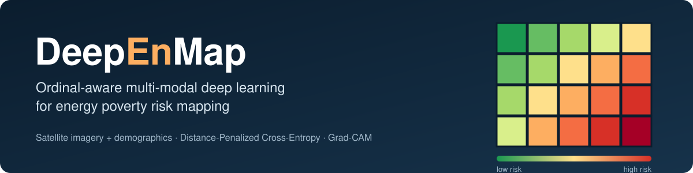
</p>

<p align="center">
  <a href="https://www.python.org/"></a>
  <a href="https://www.tensorflow.org/"></a>
  
  
  <a href="LICENSE"></a>
  <a href="https://colab.research.google.com/"></a>
</p>

<p align="center">
  <b>Fusing satellite imagery and demographic data to map energy poverty risk,<br>with a loss that knows a near miss from a far one.</b>
</p>

<p align="center">
  <a href="#-overview">Overview</a> ·
  <a href="#-method">Method</a> ·
  <a href="#-results">Results</a> ·
  <a href="#-ablation-and-cost">Ablation</a> ·
  <a href="#-explainability">Explainability</a> ·
  <a href="#-quick-start">Quick start</a> ·
  <a href="#-citation">Citation</a>
</p>

---

## 🔭 Overview

Energy poverty risk is **ordinal**: calling a severe-risk region "moderate" is a small mistake, but calling it "low" can misdirect real resources. Standard cross-entropy treats both errors the same.

**DeepEnMap** is a multi-modal deep learning framework that takes this ordering into account:

| | Contribution | What it does |
|:--:|---|---|
| 🎯 | **Distance-Penalized Cross-Entropy (DPCE)** | Adds a penalty on probability placed on ordinally distant wrong classes. With λ = 0 it is exactly standard cross-entropy. |
| 📏 | **Mean Absolute Ordinal Error (MAOE)** | Measures *how many risk steps* a prediction is off by, not just whether it is wrong. |
| 🔗 | **Multi-modal fusion** | A CNN over Sentinel-2 patches and a dense encoder over demographics, trained end-to-end. |
| 🔍 | **Grad-CAM explainability** | Saliency maps computed for the DPCE-trained model, showing which image regions drive each risk prediction. |

> 📄 Accepted at **IEMIS 2026** (University of British Columbia, Vancouver) for publication in **Springer LNNS**.

---

## 🧠 Method

### The DPCE loss

For a batch of size $B$, $K$ ordinal classes, true rank $y_i$ and predicted probabilities $\hat{Y}_{i,c}$:

$$
\mathcal{L}_{\text{DPCE}} = \frac{1}{B}\sum_{i=1}^{B}\left[-\log \hat{Y}_{i,y_i} + \lambda \sum_{c=1}^{K} \frac{|y_i - c|}{K-1}\hat{Y}_{i,c}\right]
$$

The first term is standard cross-entropy. The second pushes probability mass away from classes that are far from the true rank, scaled by penalty strength $\lambda$.

### Data

The experiments use **[EuroSAT RGB](https://www.kaggle.com/datasets/apollo2506/eurosat-dataset)** (Sentinel-2 patches, 10 land-use classes, 27,000 images). The 10 classes are mapped to 7 ordinal risk ranks:

<p align="center">
  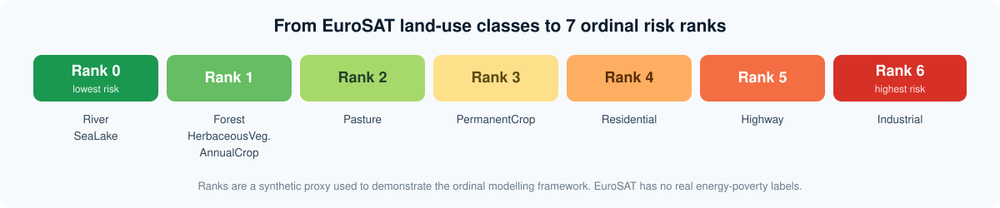
</p>

> [!IMPORTANT]
> EuroSAT has no real energy-poverty labels. The risk ranks and the four demographic features (income index, unemployment rate, building-age index, population density) are **synthetic**, generated to correlate with rank plus noise. They demonstrate how the framework behaves, not real-world poverty levels. To apply DeepEnMap to real data, replace `build_synthetic_demographics()` in the code with real census features.

<p align="center">
  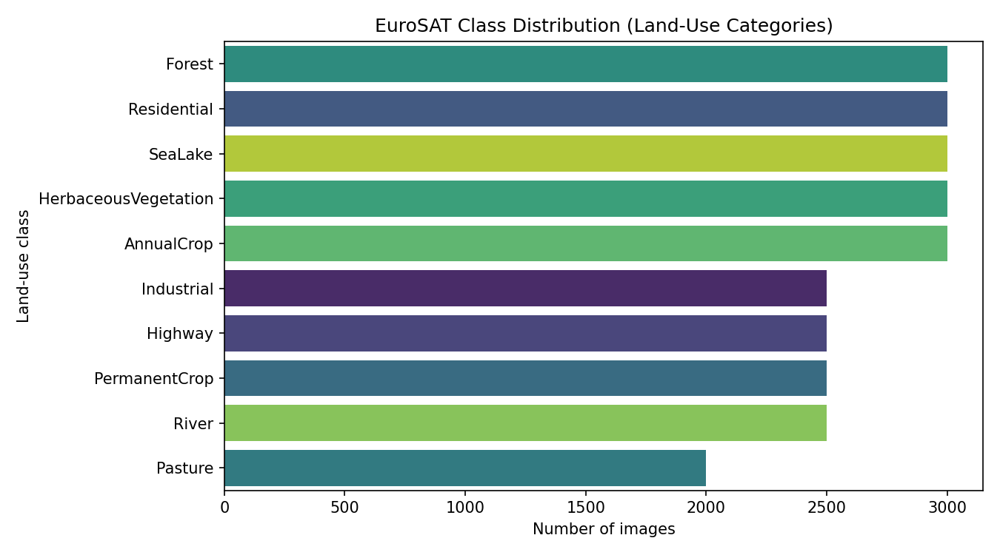
  &nbsp;
  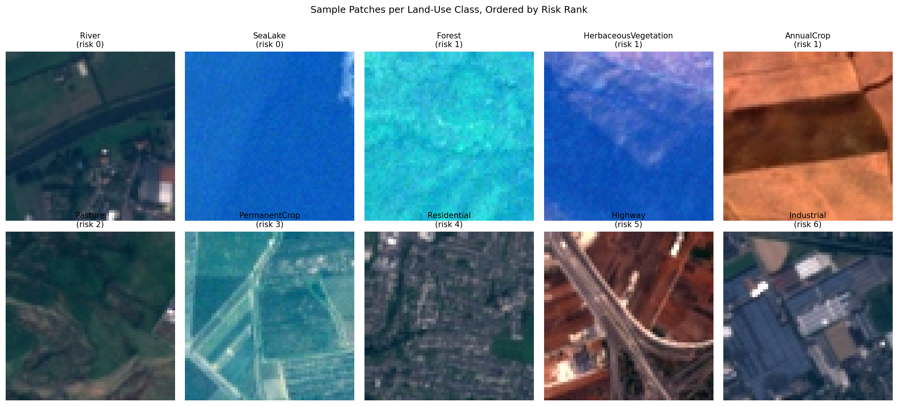
</p>
<p align="center"><sub>Images per land-use class (left) and sample patches ordered by risk rank (right).</sub></p>

### Architecture

<p align="center">
  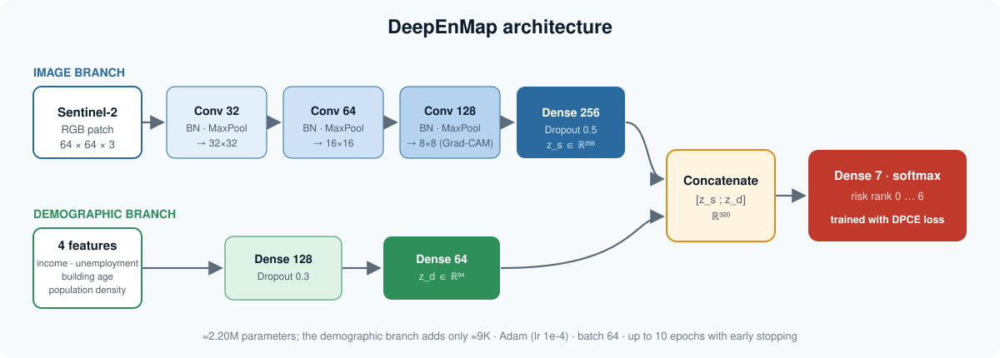
</p>

<details>
<summary>Full Keras layer graph</summary>
<p align="center">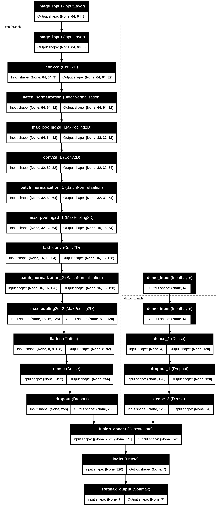</p>
</details>

### Training setup

| Setting | Value |
|---|---|
| Split | 80 / 20, stratified by risk rank |
| Optimizer | Adam, learning rate 1e-4, batch size 64 |
| Epochs | up to 10, early stopping (patience 3) |
| Seeds | 5 (7, 42, 99, 123, 2024), shared across every configuration |
| Hardware | single NVIDIA T4 (16 GB) on Google Colab, about 2 min per run |

---

## 📊 Results

### Experiment 1: DPCE vs. standard cross-entropy

Multi-modal model, λ = 1, mean ± std over 5 seeds.

| Loss | Accuracy ↑ | MAOE ↓ | Macro F1 ↑ |
|---|:---:|:---:|:---:|
| Standard cross-entropy | 0.9157 ± 0.0099 | 0.1229 ± 0.0151 | 0.9096 ± 0.0105 |
| **DPCE (λ = 1)** | **0.9166 ± 0.0092** | **0.1201 ± 0.0130** | **0.9102 ± 0.0104** |

DPCE matches cross-entropy on accuracy and has a slightly lower ordinal error. With 5 seeds the difference is **not statistically significant** (paired t-test: accuracy p = 0.36, d = 0.46; MAOE p = 0.13, d = −0.85).

<p align="center">
  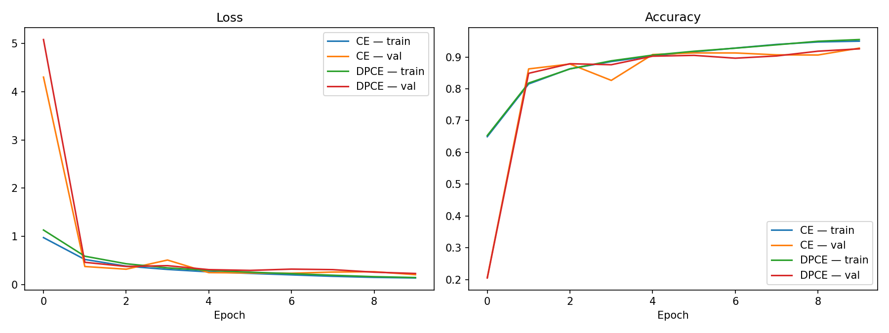
</p>
<p align="center">
  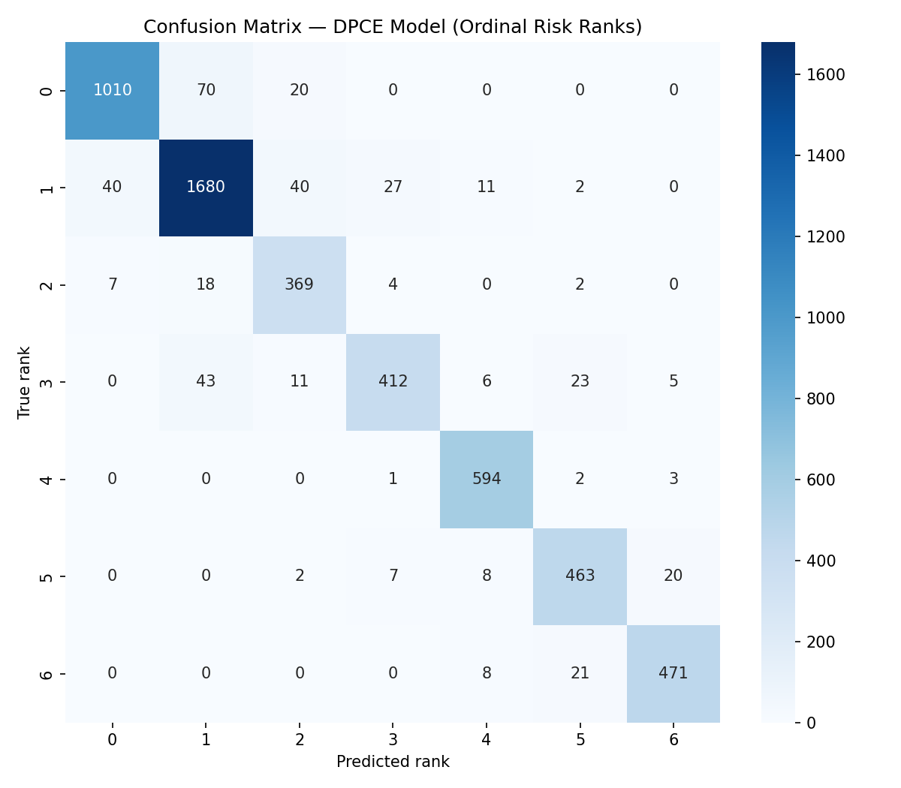
  &nbsp;
  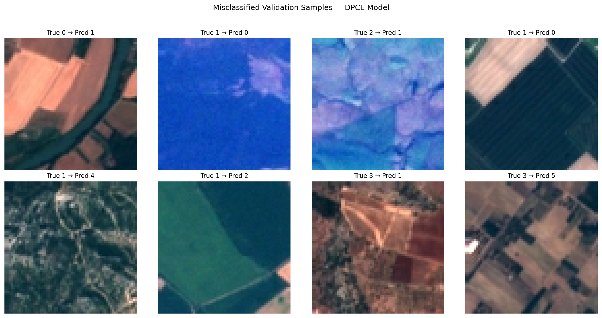
</p>
<p align="center"><sub>Most confusions fall between adjacent ranks (left). Examples of misclassified patches (right).</sub></p>

### Experiment 2: penalty strength λ

| λ | Accuracy ↑ | MAOE ↓ | Macro F1 ↑ | Holm-adjusted significance |
|:--:|:---:|:---:|:---:|:---:|
| 0 (CE) | 0.9181 ± 0.0033 | 0.1189 ± 0.0048 | 0.9130 ± 0.0027 | baseline |
| 0.5 | 0.9196 ± 0.0033 | 0.1161 ± 0.0031 | 0.9150 ± 0.0031 | no |
| 1.0 | 0.9161 ± 0.0042 | 0.1188 ± 0.0064 | 0.9092 ± 0.0066 | no |
| 2.0 | 0.9216 ± 0.0057 | 0.1124 ± 0.0077 | 0.9165 ± 0.0071 | no |
| **5.0** | **0.9225 ± 0.0049** | **0.1119 ± 0.0054** | **0.9175 ± 0.0051** | no |

<p align="center">
  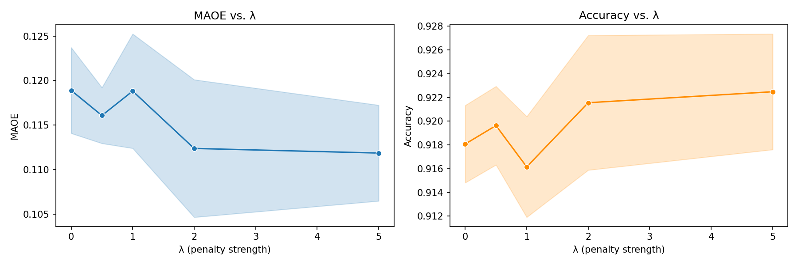
</p>

The strongest penalty (λ = 5) gives the best accuracy and MAOE, with large effect sizes (d = 1.50 and −1.47). Its raw p-values (0.028 and 0.030) do **not survive Holm–Bonferroni correction** across the four λ values. The trend favours stronger penalties, but more seeds would be needed to confirm it.

### Experiment 4: how far off are the errors?

| Distance from true rank | CE | DPCE |
|---|:---:|:---:|
| 0 (correct) | 92.80 % | 92.57 % |
| 1–2 steps (close) | 6.93 % | 7.02 % |
| 3–4 steps (moderate) | 0.28 % | 0.41 % |
| 5–6 steps (far) | 0.00 % | 0.00 % |

<p align="center">
  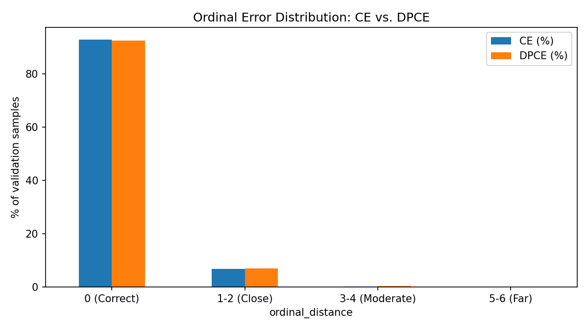
</p>

Both models make almost all of their errors within one or two ranks, and neither makes far errors. At λ = 1 on this split, DPCE does not reduce moderate errors.

---

## 🧪 Ablation and cost

### Experiment 3: which modality matters?

| Input | Accuracy ↑ | MAOE ↓ | Macro F1 ↑ | Parameters | FLOPs / inference |
|---|:---:|:---:|:---:|:---:|:---:|
| Demographics only | 0.5827 ± 0.0061 | 0.4829 ± 0.0083 | 0.4780 ± 0.0096 | 9,351 | 18.5 K |
| Image only | 0.8593 ± 0.0033 | 0.3280 ± 0.0146 | 0.8503 ± 0.0029 | 2,193,351 | 87.69 M |
| **Image + demographics** | **0.9166 ± 0.0092** | **0.1201 ± 0.0130** | **0.9102 ± 0.0104** | 2,202,695 | 87.71 M |

Fusion beats either input alone, and cuts ordinal error by almost two-thirds compared with images only. The demographic branch adds **0.4 % of the parameters** and **0.02 % of the compute**.

---

## 🔍 Explainability

Grad-CAM on the last convolutional layer of the DPCE-trained model shows which parts of each patch drive the risk prediction.

<p align="center">
  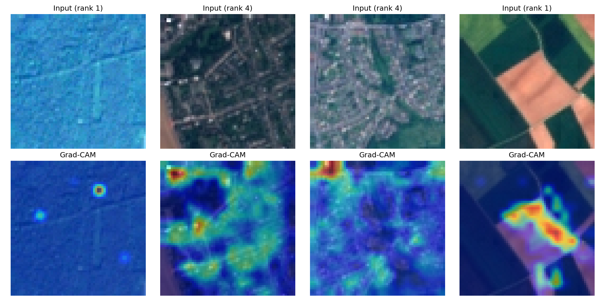
</p>

<p align="center">
  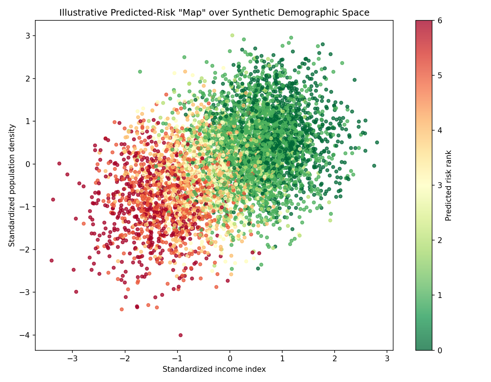
</p>
<p align="center"><sub>Predicted risk rank over the synthetic demographic space (income index vs. population density). Risk rises toward low income and low density, as the synthetic generator intended.</sub></p>

---

## 🚀 Quick start

```bash
git clone https://github.com/Junaid-Ahmed-Rupok/DeepEnMap.git
cd DeepEnMap
pip install -r requirements.txt
```

Then open [`codes/DeepEnMap_Experiments.ipynb`](codes/DeepEnMap_Experiments.ipynb) in Google Colab (GPU runtime) and run all cells. The dataset downloads automatically:

```python
import kagglehub
dataset_path = kagglehub.dataset_download("apollo2506/eurosat-dataset")
```

A plain-script version is in [`codes/deepenmap_experiments.py`](codes/deepenmap_experiments.py). To run locally, remove the `google.colab` import.

---

## 📁 Repository structure

```
DeepEnMap/
├── codes/
│   ├── DeepEnMap_Experiments.ipynb        # full experiment notebook
│   ├── DeepEnMap_Experiments.ipynb - Colab.pdf
│   └── deepenmap_experiments.py           # script version
├── Experiment_1/    # CE vs. DPCE per seed + significance tests
├── Experiment_2/    # λ sweep, Holm–Bonferroni statistics, sensitivity plot
├── Experiment_3/    # modality ablation per seed
├── Experiment_4/    # ordinal error distribution
├── Images/          # figures used in this README
├── requirements.txt
├── CITATION.cff
└── LICENSE
```

All numbers in this README are computed from the CSV files in the `Experiment_*` folders.

---

## 📜 Citation

```bibtex
@inproceedings{ahmed2026deepenmap,
  title     = {DeepEnMap: Ordinal-Aware Multi-Modal Deep Learning for Energy Poverty Risk Mapping},
  author    = {Ahmed, Sarder Junaid},
  booktitle = {Proceedings of IEMIS 2026},
  series    = {Lecture Notes in Networks and Systems},
  publisher = {Springer},
  year      = {2026}
}
```

A machine-readable citation is available in [`CITATION.cff`](CITATION.cff).

---

## 👤 Author

<table>
<tr>
<td width="110" align="center">
  
</td>
<td>

**Sarder Junaid Ahmed**<br>
Research Assistant, CAIR, Southeast University (Dhaka)<br>
Causal machine learning · trustworthy AI · fairness · uncertainty quantification

[](https://github.com/Junaid-Ahmed-Rupok)
[](https://www.linkedin.com/in/junaid-ahmed-rupok-059b68240/)
[](mailto:junaidahmedrupok@gmail.com)

</td>
</tr>
</table>

<details>
<summary><b>Other publications by the author</b></summary>

- **CF-EGAT: A Causal Fairness-Aware Equity Graph Attention Network for Country-Level Environmental Livability Classification.** SPECTRA 2026. 🏆 1st Best Paper Award
- **Multi-Dimensional Statistical Similarity for Governance Classification: Beyond Arbitrary Thresholds.** APMEE 2025. 🏆 Best Research Paper Award
- **Machine Learning for Crime Classification: A Fairness-Aware Approach to Class Imbalance.** *Journal of Machine Learning and Applications* 2(1), 9–17, 2026. [DOI](https://doi.org/10.61577/jmla.2026.100002) · conference version at IEEE SPICSCON 2026
- **Environmental Livability Assessment via Adaptive Bootstrap-Retrained SHAP and Statistically-Constrained Pareto Counterfactuals.** IEEE SPICSCON 2026
- **Density-Decoupled, Mask-Ablated Segmentation-Guided Diffusion for Controllable Mammography Synthesis.** IEMIS 2026, Springer LNNS
- **DemocracyGuard: Testing a Divergence-Index Reconciliation of Subjective and Objective Democracy Indicators.** Under review, TMLR
- **FAI: Feature-Wise Adaptive Imputation via Downstream-Aware Method Selection.** Under review, ICISET 2026

</details>

---

<p align="center"><sub>Released under the <a href="LICENSE">MIT License</a>.</sub></p>
